# File Home 软件设计说明书

| 项目 | 内容 |
| --- | --- |
| 系统名称 | File Home 个人云盘 |
| 文档版本 | 4.0 |
| 设计日期 | 2026-11-04 |
| 技术栈 | Spring Boot 4、Vue 3、MySQL、Redis、MinIO、Kafka、Nginx |
| 文档语言 | 中文 |
| 其他版本 | [Portugues](./software-design-specification-pt.md) / [English](./software-design-specification-en.md) |

## 1. 文档目的

本文档从需求、静态结构、动态行为、部署、数据、安全、性能和演进边界等方面描述 File Home。所有 UML 图使用 Mermaid 编写，可在支持 Mermaid 的 Markdown 阅读器中直接渲染。

本文档描述的是当前已实现的系统，不是只存在于概念中的目标架构。系统定位为“模块化、可横向扩展的单机个人云盘”，已经具备接入多实例、消息队列和独立对象存储的基础，但尚未完成多区域高可用。

## 2. 系统范围

### 2.1 已实现能力

- 用户注册、登录、退出、密码修改和账户注销
- HttpOnly 浏览器会话、CSRF 防护、登录和上传限流
- 用户头像上传、裁剪、缓存和删除
- 文件与文件夹浏览、搜索、排序、重命名、移动和复制
- 文件回收站、恢复和永久删除
- 小文件直传与 8 MiB 以上文件断点续传
- MinIO Multipart Upload、分片 SHA-256、Redis 分片锁和配额预留
- 文件、文件夹 ZIP 下载和 Range 流式媒体预览
- 图片、视频、音频、PDF、文本和代码只读预览
- DOCX 只读在线渲染；`.doc` 明确提示不支持
- 分享链接、提取码、分享撤销和登录后下载
- Kafka 异步活动审计与数据库回退
- 用户偏好设置和 1 到 4 路上传并发配置
- Windows/Linux CLI 客户端 `fhterm`
- Windows 本地脚本与 Linux Docker Compose 部署

### 2.2 当前边界

- MySQL、Redis、MinIO、Kafka 和 Nginx 仍以单节点本地部署为主
- Kafka 本地主题副本数为 1
- 没有管理员后台、MFA、病毒扫描、Office 服务端转换和 CDN
- 递归复制、移动、ZIP 和永久删除仍在 Web 进程内执行
- `.docx` 预览在浏览器完成，不执行服务端格式转换

## 3. 参与者与利益相关者

| 参与者 | 职责 |
| --- | --- |
| 访问者 | 打开公开分享链接，查看分享元数据 |
| 注册用户 | 管理文件、分享、账户设置和下载 |
| 命令行用户 | 通过 `fhterm` 使用同一后端 API |
| 运维人员 | 启动服务、检查健康状态、备份和日志 |
| Kafka 消费者 | 异步写入活动审计 |

## 4. 总体架构

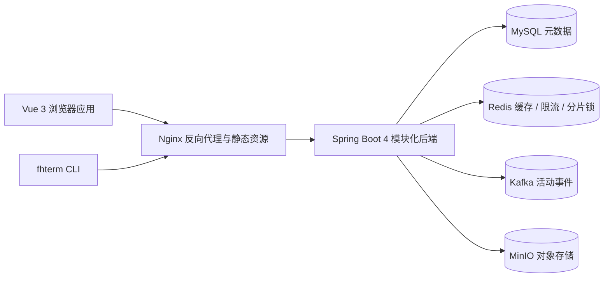

### 4.1 架构风格

- 模块化单体，但边界按业务能力划分
- Controller、Service、Repository、Storage Adapter、Message Adapter 分层
- MySQL 保存强一致元数据
- Redis 承担可重建缓存、限流和分布式分片锁
- MinIO 保存文件内容和头像
- Kafka 承担可异步处理的审计事件
- 浏览器不接触 MinIO 凭证和 MinIO Upload ID

### 4.2 关键设计原则

1. 文件元数据与对象内容分离。
2. 强一致数据留在 MySQL，Kafka 只处理可异步事件。
3. 缓存失效以事务提交为边界。
4. 浏览器和 CLI 使用独立认证通道。
5. 大文件采用服务端协调的 Multipart Upload。
6. 所有递归路径和文件名在进入存储层前做边界检查。
7. 公开分享链接不包含数据库主键。

## 5. 用例图

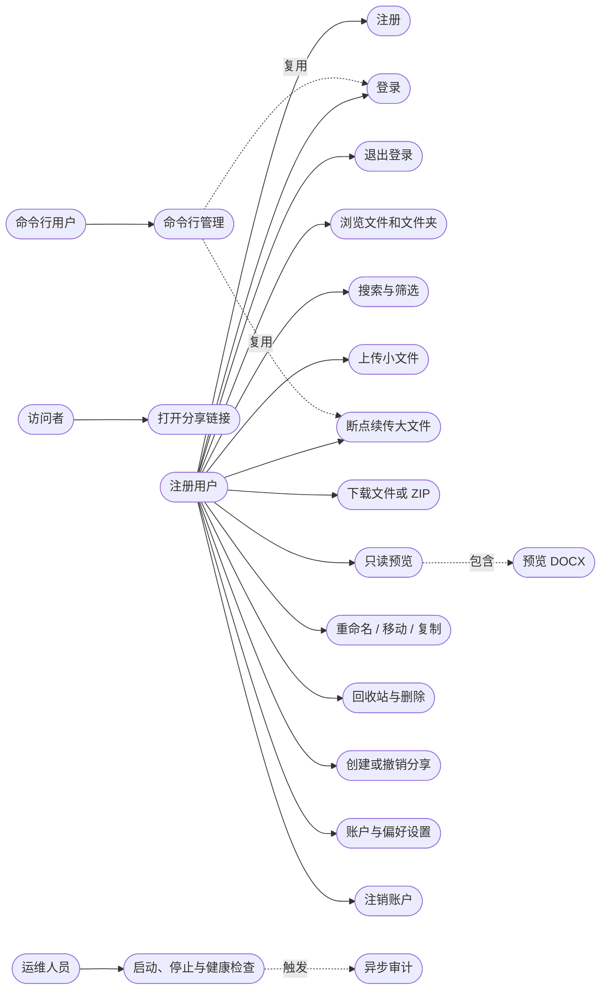

### 5.1 主要业务规则

- 注册用户名唯一，并作为用户 MinIO 根目录。
- 所有文件资源必须验证 `owner_id`。
- 文件夹分享按根条目递归解释，不复制子树快照。
- 分享下载前必须登录。
- 活动审计必须保留历史 `entry_id`，不能依赖文件仍存在。
- 账户注销是立即停用，不做同步物理删除。

## 6. 活动图

### 6.1 大文件上传活动

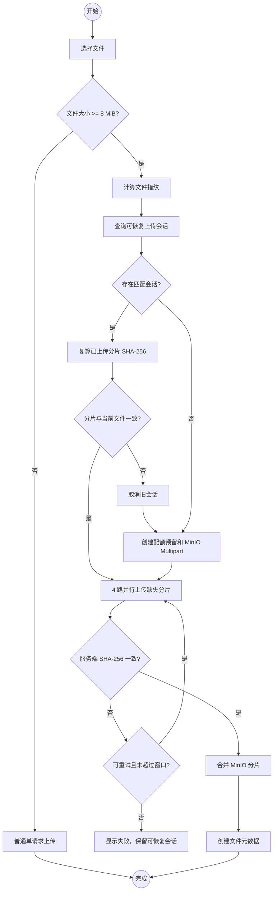

### 6.2 登录活动

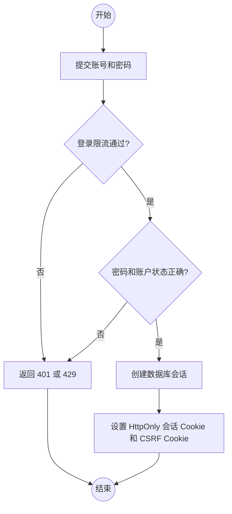

## 7. 顺序图

### 7.1 登录与浏览器会话

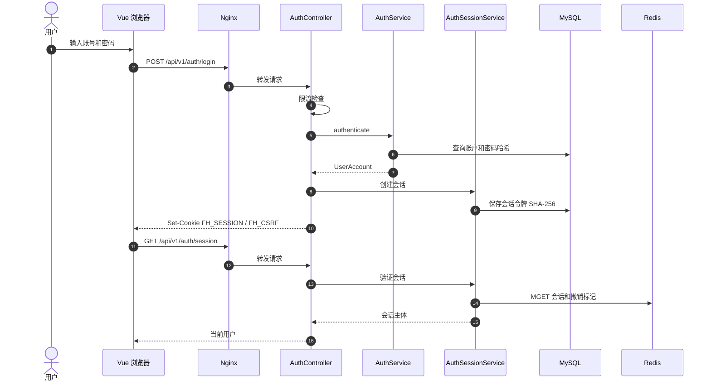

### 7.2 Multipart Upload

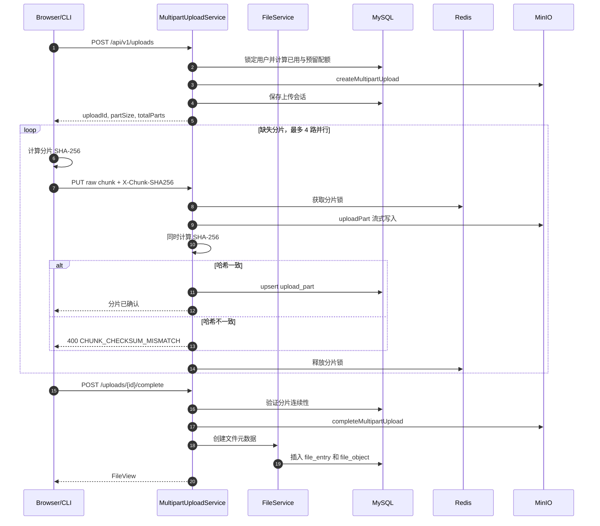

### 7.3 安全 DOCX 预览

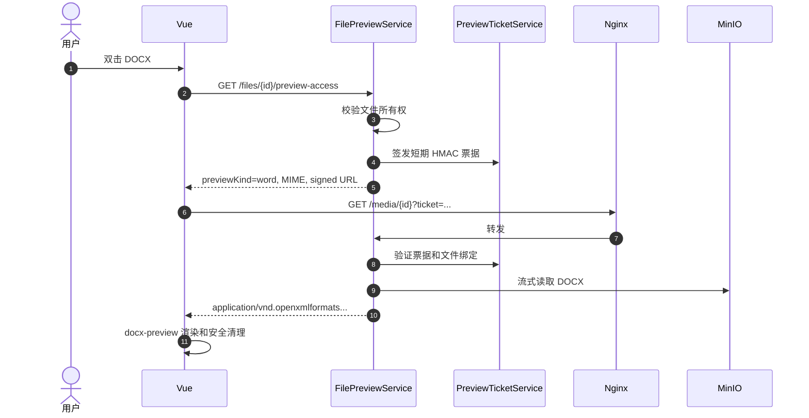

### 7.4 Kafka 异步审计

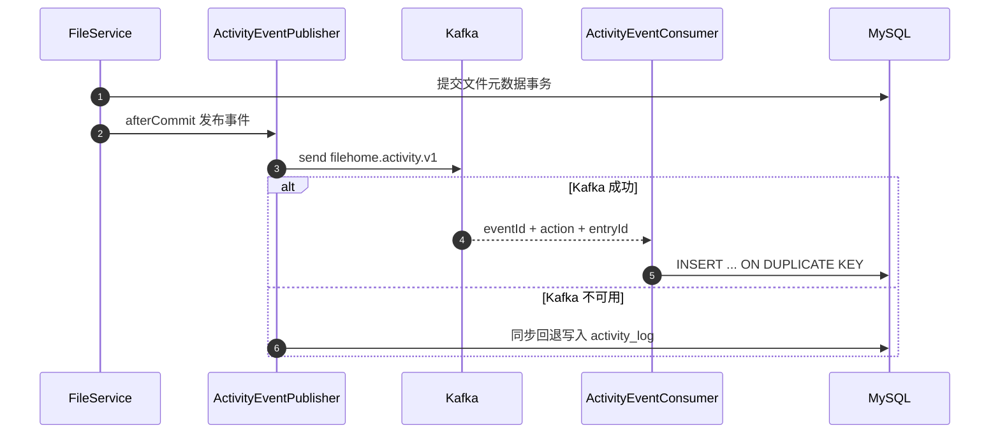

## 8. 通信图

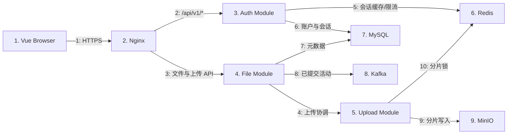

## 9. 交互概览图

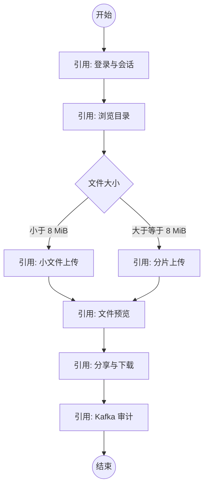

## 10. 时间图

```mermaid
gantt
    title 会话有效性与上传重试窗口
    dateFormat X
    axisFormat %S
    section 浏览器会话
    会话有效 :active, s1, 0, 3600
    section 分片上传
    4 路并行传输 :a1, 10, 25
    网络中断 :crit, a2, 35, 20
    指数退避与抖动 :a3, 35, 46
    会话仍可恢复 :active, a4, 35, 100
    需要重新选择文件 :milestone, m1, 82, 0
```

说明：

- 普通 API 常采用 3 次重试。
- 可恢复上传使用最多 8 次网络重试。
- 重试延迟加入随机抖动，避免大量客户端同时重连。
- 超过客户端重试窗口后，服务端会话仍保留 48 小时。

## 11. 状态机图

### 11.1 文件生命周期

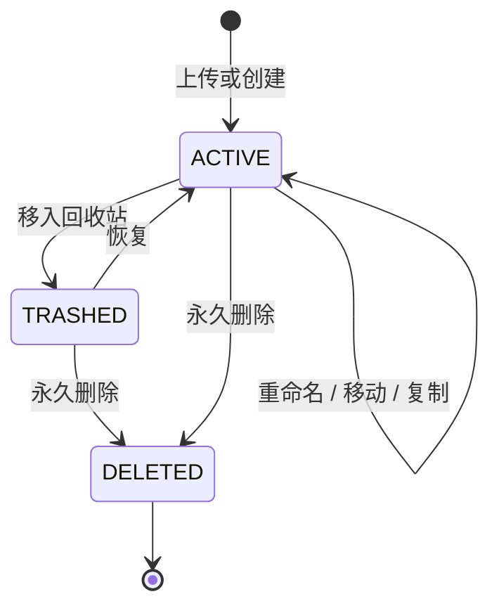

### 11.2 上传会话生命周期

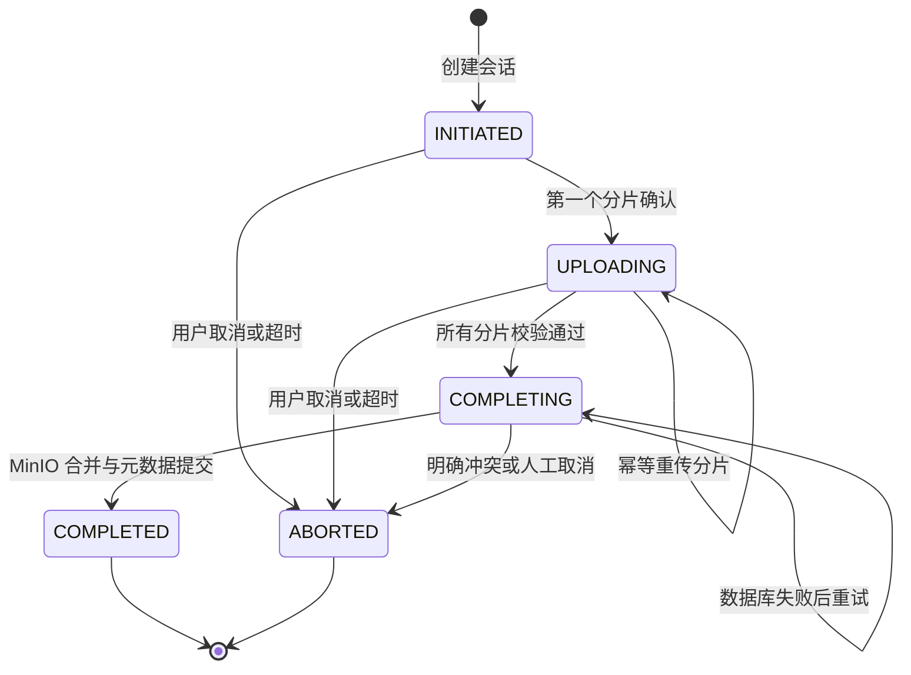

### 11.3 账户生命周期

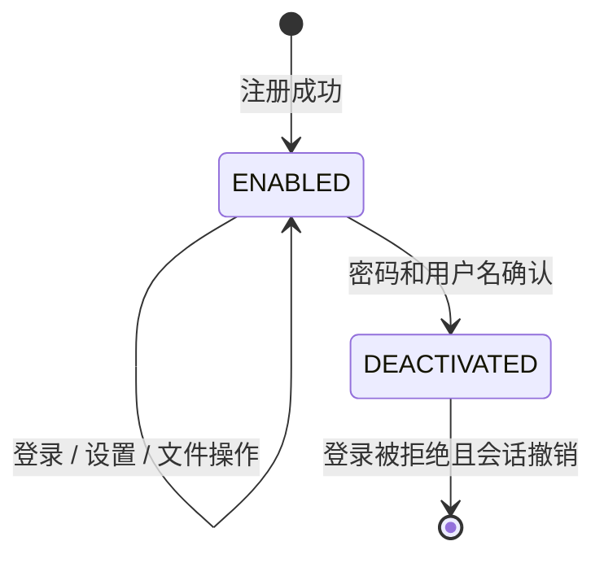

## 12. 类图

### 12.1 领域模型类图

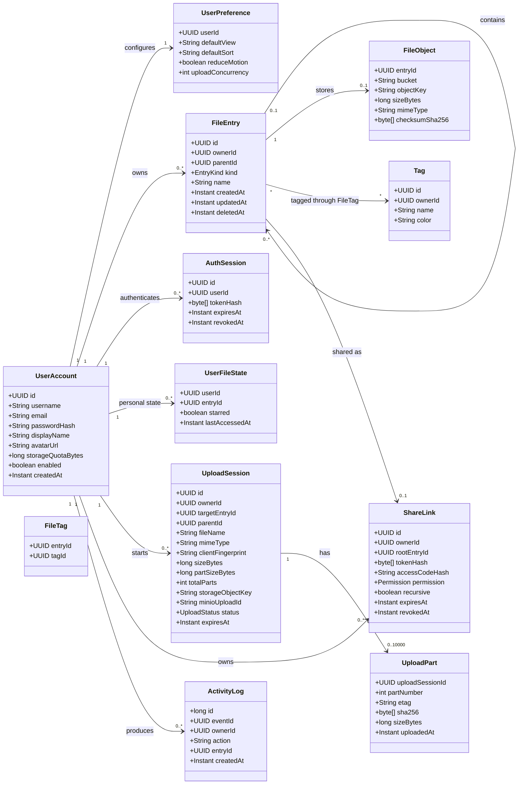

### 12.2 应用服务与端口类图

```mermaid
classDiagram
    direction TB

    class AuthController
    class AuthService
    class JwtService
    class AuthSessionService
    class AuthInterceptor
    class RequestAuthenticator

    class UserController
    class UserService
    class UserSettingsService
    class UserAvatarService

    class FileController
    class FileService
    class FileMetadataCache
    class FilePreviewService
    class PreviewTicketService

    class MultipartUploadController
    class MultipartUploadService
    class UploadPartLock
    class MultipartUploadRepository

    class ShareController
    class PublicShareController
    class ShareService

    class ActivityEventPublisher
    class ActivityEventConsumer
    class ActivityLogRepository

    class UserRepository
    class FileRepository
    class ShareRepository
    class AuthSessionRepository
    class UserPreferenceRepository

    class ObjectStoragePort
    class MultipartUploadStoragePort
    class StorageReservationPort
    class MinioObjectStorageAdapter
    class MinioMultipartStorageAdapter

    AuthController --> AuthService
    AuthController --> AuthSessionService
    AuthInterceptor --> RequestAuthenticator
    RequestAuthenticator --> JwtService
    RequestAuthenticator --> AuthSessionService
    AuthService --> UserService
    AuthSessionService --> AuthSessionRepository

    UserController --> UserService
    UserController --> UserSettingsService
    UserController --> UserAvatarService
    UserService --> UserRepository
    UserSettingsService --> UserPreferenceRepository

    FileController --> FileService
    FileController --> FilePreviewService
    FileService --> FileRepository
    FileService --> FileMetadataCache
    FileService --> ObjectStoragePort
    FileService --> StorageReservationPort
    FilePreviewService --> PreviewTicketService
    FilePreviewService --> ObjectStoragePort

    MultipartUploadController --> MultipartUploadService
    MultipartUploadService --> MultipartUploadRepository
    MultipartUploadService --> MultipartUploadStoragePort
    MultipartUploadService --> UploadPartLock
    MultipartUploadService --> FileService

    ShareController --> ShareService
    PublicShareController --> ShareService
    ShareService --> ShareRepository

    FileService --> ActivityEventPublisher
    ActivityEventPublisher --> ActivityLogRepository
    ActivityEventConsumer --> ActivityLogRepository

    ObjectStoragePort <|.. MinioObjectStorageAdapter
    MultipartUploadStoragePort <|.. MinioMultipartStorageAdapter
```

## 13. 对象图

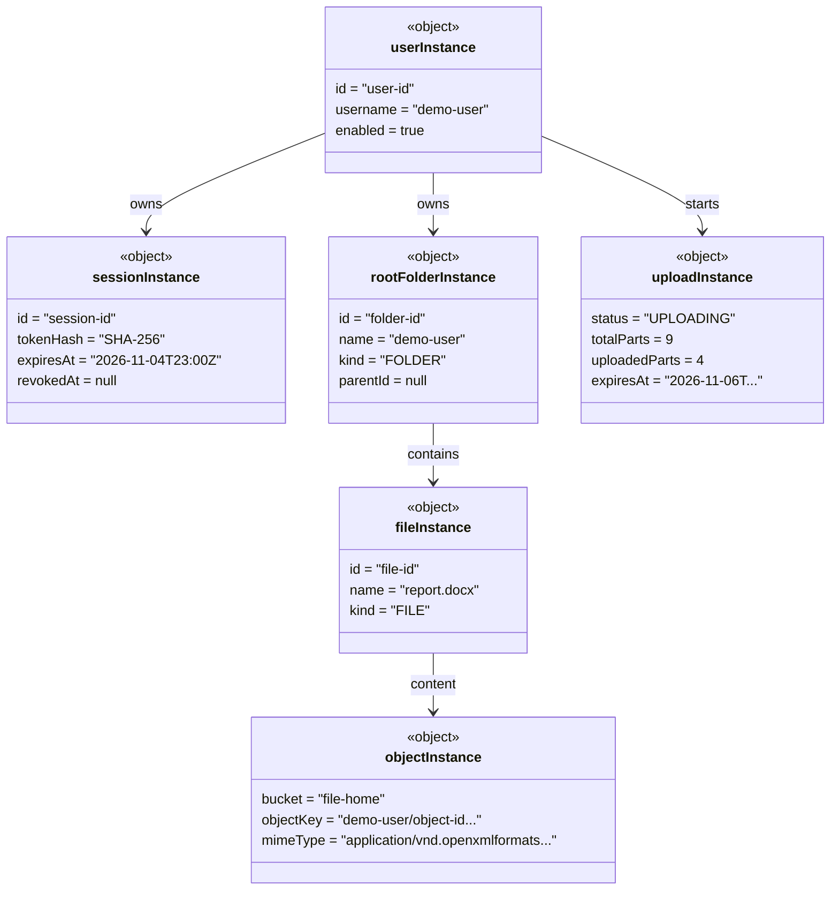

## 14. 包图

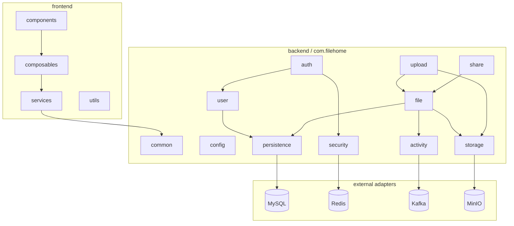

## 15. 组件图

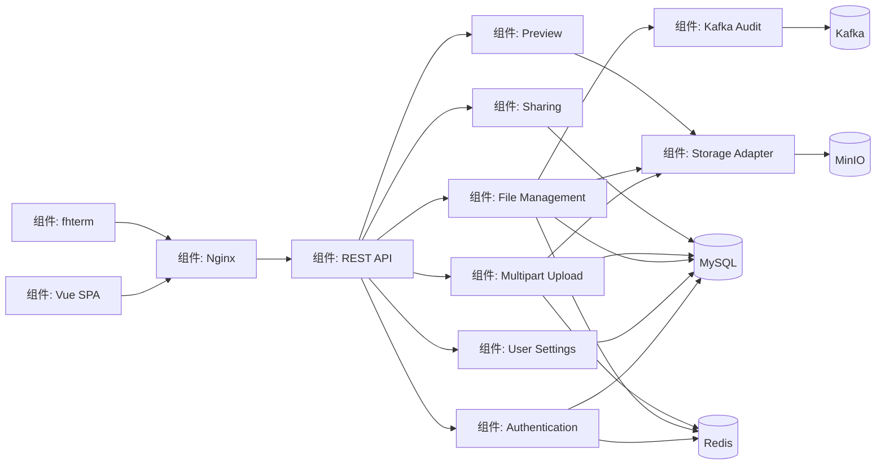

## 16. 复合结构图

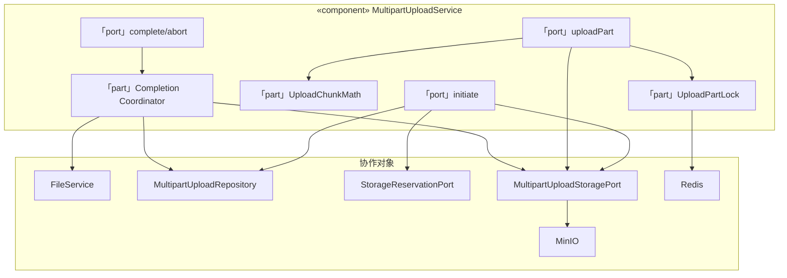

## 17. 部署图

```mermaid
flowchart TB
    subgraph ClientNode["«device» 客户端"]
        Browser["«artifact» Vue SPA"]
        Terminal["«artifact» fhterm"]
    end

    subgraph EdgeNode["«node» Nginx 边缘节点"]
        ReverseProxy["«artifact» filehome.conf"]
        Static["«artifact» frontend/dist"]
    end

    subgraph AppNode["«node» Spring Boot 应用"]
        BackendJar["«artifact» filehome-backend.jar"]
        KafkaConsumer["«component» Activity Consumer"]
    end

    subgraph DataNode["«node» 数据服务"]
        MySQL["«database» MySQL 8"]
        Redis["«database» Redis"]
        Kafka["«message broker» Kafka"]
        MinIO["«object store» MinIO"]
    end

    subgraph StorageNode["«node» 文件系统"]
        MySQLVolume["mysql_data"]
        RedisVolume["redis_data"]
        KafkaVolume["kafka_data"]
        MinIOVolume["minio_data"]
    end

    Browser --> ReverseProxy
    Terminal --> ReverseProxy
    ReverseProxy --> BackendJar
    Static --> Browser
    BackendJar --> MySQL
    BackendJar --> Redis
    BackendJar --> Kafka
    BackendJar --> MinIO
    KafkaConsumer --> Kafka
    MySQL --> MySQLVolume
    Redis --> RedisVolume
    Kafka --> KafkaVolume
    MinIO --> MinIOVolume
```

### 17.1 部署说明

- Windows 开发环境使用 `scripts/filehome.ps1`。
- Linux 推荐使用 Docker Compose。
- Kafka 本地 Windows 使用 Git Bash 执行官方 4.4.0 KRaft 脚本。
- Docker Compose 使用 Kafka 4.1.2 官方镜像。
- 生产环境需启用 TLS、独立最小权限数据库账户和离机备份。

## 18. 配置档案图

```mermaid
classDiagram
    class ApplicationService {
        <<stereotype>>
        @Service
        transactionalBoundary
    }
    class RepositoryMapper {
        <<stereotype>>
        @Mapper
        persistenceBoundary
    }
    class StorageAdapter {
        <<stereotype>>
        @Component
        externalStorageBoundary
    }
    class SecurityInterceptor {
        <<stereotype>>
        @Component
        authenticationPolicy
    }
    class KafkaConsumer {
        <<stereotype>>
        @KafkaListener
        idempotentConsumer
    }
    class RestController {
        <<stereotype>>
        @RestController
        httpContract
    }

    RestController --> ApplicationService : delegates
    ApplicationService --> RepositoryMapper : persists
    ApplicationService --> StorageAdapter : stores objects
    RestController --> SecurityInterceptor : protected by
    ApplicationService --> KafkaConsumer : emits events to
```

该档案图定义项目使用的稳定构造型。新增模块时应复用这些边界，不允许 Controller 直接访问 Mapper 或 MinIO SDK。

## 19. 数据关系图

```mermaid
erDiagram
    USER_ACCOUNT ||--o| USER_PREFERENCE : has
    USER_ACCOUNT ||--o{ FILE_ENTRY : owns
    USER_ACCOUNT ||--o{ AUTH_SESSION : authenticates
    USER_ACCOUNT ||--o{ UPLOAD_SESSION : starts
    USER_ACCOUNT ||--o{ SHARE_LINK : creates
    USER_ACCOUNT ||--o{ ACTIVITY_LOG : produces
    FILE_ENTRY ||--o| FILE_OBJECT : stores
    FILE_ENTRY ||--o{ FILE_ENTRY : contains
    FILE_ENTRY ||--o{ USER_FILE_STATE : state
    FILE_ENTRY ||--o{ FILE_TAG : tagged
    TAG ||--o{ FILE_TAG : classifies
    FILE_ENTRY ||--o| SHARE_LINK : shared
    UPLOAD_SESSION ||--o{ UPLOAD_PART : contains
    SHARE_LINK ||--o{ SHARE_ACCESS_LOG : records

    USER_ACCOUNT {
        char36 id PK
        varchar username UK
        varchar email UK
        varchar password_hash
        bigint storage_quota_bytes
        boolean is_enabled
        datetime deactivated_at
    }
    FILE_ENTRY {
        char36 id PK
        char36 owner_id FK
        char36 parent_id FK
        enum entry_kind
        varchar name
        datetime deleted_at
    }
    FILE_OBJECT {
        char36 entry_id PK
        varchar storage_bucket
        varchar storage_object_key
        bigint size_bytes
        varchar mime_type
    }
    UPLOAD_SESSION {
        char36 id PK
        char36 owner_id FK
        char36 target_entry_id
        char36 parent_id FK
        bigint size_bytes
        bigint part_size_bytes
        int total_parts
        enum status
    }
    UPLOAD_PART {
        char36 upload_session_id PK
        int part_number PK
        varchar etag
        binary sha256
        bigint size_bytes
    }
    ACTIVITY_LOG {
        bigint id PK
        char36 event_id UK
        char36 owner_id FK
        varchar activity_action
        char36 entry_id
    }
```

## 20. 接口设计摘要

| 模块 | 方法与路径 | 说明 |
| --- | --- | --- |
| 认证 | `POST /api/v1/auth/login` | 创建浏览器会话 |
| 认证 | `POST /api/v1/auth/cli/login` | 创建 CLI Bearer Token |
| 认证 | `GET /api/v1/auth/session` | 恢复浏览器会话 |
| 认证 | `POST /api/v1/auth/logout` | 立即撤销当前会话 |
| 用户 | `GET /api/v1/users/me/settings` | 用户资料和偏好 |
| 用户 | `PATCH /api/v1/users/me/settings` | 更新偏好 |
| 用户 | `PATCH /api/v1/users/me/profile` | 更新资料 |
| 用户 | `POST /api/v1/users/me/password` | 修改密码 |
| 用户 | `POST /api/v1/users/me/deactivate` | 注销账户 |
| 文件 | `GET /api/v1/files` | 游标分页目录 |
| 文件 | `POST /api/v1/files/upload` | 小文件上传 |
| 文件 | `GET /api/v1/files/{id}/preview-access` | 获取短期预览票据 |
| 上传 | `POST /api/v1/uploads` | 创建分片上传会话 |
| 上传 | `PUT /api/v1/uploads/{id}/parts/{n}` | 原始二进制分片 |
| 上传 | `POST /api/v1/uploads/{id}/complete` | 完成 Multipart |
| 分享 | `GET /api/v1/public/shares/{token}` | 公开分享元数据 |
| 分享 | `GET /api/v1/public/shares/{token}/download` | 登录后下载 |
| 媒体 | `GET /api/v1/media/{id}?ticket=` | Range 流式预览 |

## 21. 安全设计

| 威胁 | 控制措施 |
| --- | --- |
| XSS 窃取令牌 | 浏览器使用 HttpOnly Cookie，不在 JavaScript 中保存 JWT |
| CSRF | 非安全方法校验 `X-CSRF-Token`，HMAC 与会话绑定 |
| 会话盗用 | 数据库仅存令牌哈希，可即时撤销 |
| 资源越权 | 所有文件、上传、分享操作验证 owner ID |
| 分享链接枚举 | 随机高熵 token，数据库只存哈希 |
| 提取码泄露 | PBKDF2 哈希保存，兼容路径常量时间比较 |
| 路径穿越 | 文件名净化、MinIO 对象 key 校验 |
| 分片篡改 | 客户端和服务端双重 SHA-256 |
| 并发同片覆盖 | Redis 分片锁 |
| 预览票据泄露 | 短期 HMAC、文件绑定、撤销即时失效 |
| DOCX 外链 | CSP、自渲染后清理危险 DOM 和外部图片 |
| 审计丢失 | Kafka 失败回退数据库，eventId 幂等 |

生产环境必须启用 HTTPS。Kafka 在公网或不可信网络中必须启用 SASL/TLS。

## 22. 性能设计

### 22.1 已实施优化

- 目录查询使用游标分页，最多 200 项一页
- Redis 缓存目录、树、详情、最近和星标
- MySQL 索引支持 owner、parent、deleted、updated、id 排序
- 会话鉴权使用 Redis 缓存和撤销标记
- 固定窗口限流由 Redis Lua 原子执行
- Kafka 异步审计使用 LZ4、批量、幂等 Producer 和 3 个 Consumer
- 大文件使用 16 MiB 分片、4 路并行、流式写入
- 配额预留避免并发上传超卖
- DOCX 渲染器独立懒加载
- HikariCP 和 Tomcat 参数可配置

### 22.2 已测量结果

| 场景 | 结果 |
| --- | --- |
| 会话鉴权 48 并发 | 中位数约 1958 req/s，p95 约 37 ms |
| 目录 48 并发 | 中位数约 1652 req/s，p95 约 40.5 ms |
| 健康接口 | 中位数约 2501 req/s |
| 128 MiB 分片上传 | 约 40 到 51 MiB/s |

这些是单机本地测量，不代表公网容量。

## 23. 可测试性与可观测性

- 单元测试覆盖密码、票据、Range、格式识别、限流、分片边界、头像、设置和注销
- `tools/performance-benchmark.mjs` 执行并发压测
- `tools/multipart-upload-smoke.mjs` 执行真实分片上传和整文件哈希校验
- `tools/kafka-audit-smoke.mjs` 验证 Kafka 审计
- `tools/docx-preview-smoke.mjs` 验证真实 DOCX 预览资源
- `/api/v1/health` 提供基础健康检查
- 下一阶段应增加 Prometheus、Grafana 和 OpenTelemetry

## 24. 需求追踪矩阵

| 需求 | 实现模块 | 视图 |
| --- | --- | --- |
| 浏览器安全登录 | auth/session | 用例图、顺序图、状态机 |
| 分片断点续传 | upload、MinIO adapter | 活动图、顺序图、复合结构 |
| 用户设置与注销 | user、AuthSessionService | 用例图、类图、状态机 |
| Word 预览 | file preview、DocxPreview.vue | 顺序图、组件图 |
| Kafka 审计 | activity | 顺序图、组件图、部署图 |
| 高并发目录 | FileService、Redis cache | 组件图、类图、性能章节 |
| Linux 部署 | Docker Compose、Nginx | 部署图 |

## 25. 后续演进

1. 引入 Flyway 统一数据库迁移。
2. 增加 OpenAPI 契约和 CI 质量门禁。
3. 将递归复制、ZIP、缩略图和病毒扫描迁移到 Kafka Worker。
4. Kafka 至少三节点、副本数 3，并引入 Schema Registry。
5. MySQL、Redis、MinIO 和 Nginx 增加高可用。
6. 增加 MFA、HttpOnly + CSRF 已完成的会话体系之外的服务端令牌撤销策略。
7. 增加 Prometheus、Grafana、OpenTelemetry 和正式容量压测。

## 26. 结论

File Home 采用清晰分层的模块化单体设计，同时保留了水平扩展所需的共享状态和无状态请求路径。大文件、身份会话、Kafka 审计和 DOCX 预览均已有真实实现。当前设计适合课程项目、个人网盘和中小规模部署；升级到企业级平台的主要工作是基础设施高可用、异步任务 Worker、集中迁移、全链路观测和容量治理。
